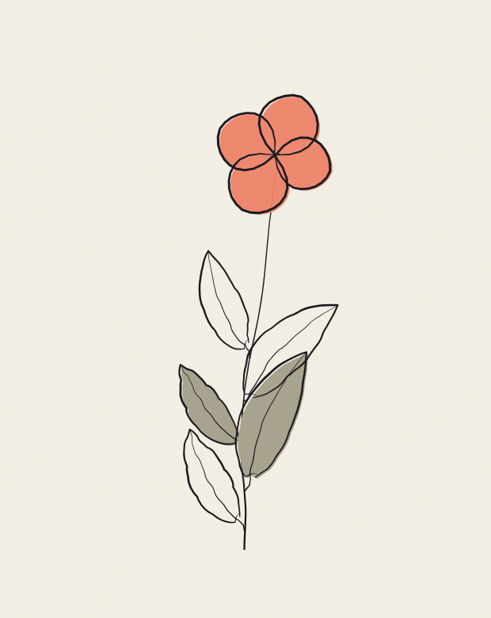
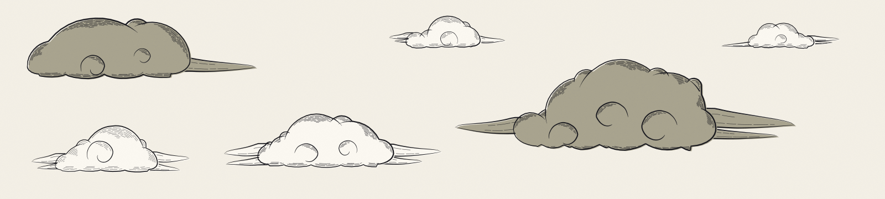

# biome-illustrator

**English** · [Español](README.es.md)

A generative illustration engine for SVG, deterministic by seed. One integer
produces one plate, and the same integer always produces the same plate, byte
for byte. Plants, trees, clouds and landscapes all come from the same
contract, drawn with a pen stroke, imperfect registration and paper grain.

<p>
  
  
  
</p>



- Zero dependencies. Runs in the browser and in Node.
- Returns a self-contained SVG string: no external fonts or images.
- ESM only, fully typed. Optional React component.

## Installation

```sh
npm install biome-illustrator
# or
pnpm add biome-illustrator
```

| Entry point | What it provides |
|---|---|
| `biome-illustrator` | the engine: `renderIllustration`, `renderMotif`, `renderPiece`, the garden pieces, palettes, formats, subjects, `paletteVars`, `toCssColors`, `describeIllustration` |
| `biome-illustrator/core` | primitives: seeded randomness, noise, geometry and strokes (`createRng`, `hashSeed`, `lerp`, `clamp`, `makeNoise`, `polyline`, `tapered`, `wobble`, …) |
| `biome-illustrator/react` | `<Illustration />`; requires `react` 18 or later (an optional peer dependency, only for this entry point) |

## Usage

```ts
import { renderIllustration } from 'biome-illustrator'

const svg = renderIllustration({ seed: 4821, subject: 'ink', palette: 'riso' })
document.querySelector('#plate')!.innerHTML = svg
```

With React:

```tsx
import { Illustration } from 'biome-illustrator/react'

<Illustration seed={4821} subject="ink" palette="riso" animate />
<Illustration seed={9010} subject="dunes" palette="herbarium" format="wide" animate />
```

The component injects exactly the string returned by `renderIllustration`, so
what you see and what you download are the same file.

### Choosing a seed

The seed is any integer; it picks the drawing, not its quality. A few ways to
get one:

```ts
import { hashSeed } from 'biome-illustrator/core'

// 1. Curated: browse seeds in the studio (`pnpm dev`) and keep the ones you like.
const seed = 4821

// 2. From a string: stable per page, post or user, with no list to maintain.
const seed = hashSeed('my-blog-post-slug')

// 3. Random: a different drawing on every load.
const seed = Math.floor(Math.random() * 100_000)

// 4. From the date: one drawing per day, the same for every visitor.
const seed = hashSeed(new Date().toISOString().slice(0, 10))
```

When the seed is random and you want to recreate a drawing later, store it:
every SVG carries it in its `data-seed` attribute.

## Features

- **Seven subjects**: three botanicals (`flat`, `ink`, `line`), a tree
  (`grove`), an engraved sky (`cumulus`), a banded landscape (`dunes`) and a
  garden ground (`meadow`).
- **Three formats**: plate 620 × 780 (`plate`), band 1600 × 360 (`wide`) and
  square 900 × 900 (`square`). Each subject declares which ones it can compose.
- **Six palettes**: `herbarium`, `riso`, `mono`, `night`, `garden` and
  `garden-night`, or your own.
- **Standalone motifs**: a single plant cropped to its bounding box, with its
  anchor point.
- **Garden pieces**: sun, moon with phases, grass tufts, daisy, stone, bush,
  large leaf, cypress, round tree, hills, trail and lantern.
- **Growth**: the same plant from sprout to flower (`growth`).
- **Colors as CSS variables**, to retint live without redrawing.
- **Pen weight tuned to the final size** and configurable **registration**
  between color and line.

## API

Every option beyond the basics is opt-in: without it, the SVG is identical
byte for byte.

### `renderIllustration(options): string`

```ts
renderIllustration({
  seed: 4821,
  subject: 'ink',            // flat | ink | line | grove | cumulus | dunes | meadow
  palette: 'garden',         // a palette id or your own { paper, ink, accent, …, flower? }
  format: 'plate',           // plate | wide | square
  registration: 2.5,         // offset between color and line, in px (0 to 8)
  animate: false,            // staggered entrance and gentle drift, in CSS
  grain: true,               // paper grain
  paper: true,               // false: transparent background
  colors: 'hex',             // 'css' → style="fill:var(--bi-ink,#2B2A28)"
  displayWidth: undefined,   // actual px: thickens the pen when drawn small
  growth: 1,                 // 0..1, botanicals: sprout → bud (0.45) → flower (0.72)
})
```

### `renderMotif(options): Motif`

A single plant cropped to the bounding box of its drawing, transparent, with no
ground line, and with the foot of its stem as the anchor. Subjects: `line`,
`ink`, `flat` and `grove`.

```ts
import { renderMotif } from 'biome-illustrator'
import { hashSeed } from 'biome-illustrator/core'

const m = renderMotif({ seed: hashSeed('reef'), subject: 'line', palette: 'garden',
  growth: 0.4, scale: 0.2, colors: 'css' })
// m.svg                    viewBox="0 0 w h", with width and height in px
// m.width, m.height        size in px
// m.bbox                   bounding box of the drawing, in viewBox units
// m.anchor, m.anchorFrac   foot of the stem (in units, and as a 0..1 fraction)
```

`scale` (px per unit) keeps every plant at the same scale; `displayWidth` sets
the width of each one.

### `renderPiece(options): string`

A single garden piece, each on its own canvas (`PIECE_CANVAS`, adjustable with
`width` and `height`). Pieces that stand have their foot at the bottom center
(`pieceFoot`).

```ts
renderPiece({ kind: 'moon', seed: 3, palette: 'garden-night', phase: 0.25 })
renderPiece({ kind: 'lantern', seed: 8, palette: 'garden', colors: 'css' })
```

- `kind`: `sun`, `moon`, `tuft`, `daisy`, `stone`, `bush`, `leaf`, `cypress`,
  `round-tree`, `hills`, `trail` or `lantern`.
- **Moon**: `phase` from 0 to 1 (0 new, 0.25 first quarter, 0.5 full), as seen
  from the northern hemisphere.
- **Lantern**: standing, hanging paper or stone; in `renderPiece` the seed
  picks the style. By hand,
  `lantern(p, base, height, { ink, body, glass }, { style, layer })` sets the
  style (`post`, `paper` or `stone`) and draws a single layer (`fill`, `glass`
  or `ink`) with the same geometry, so the glass can be lit at night.
- **Hills**: every layer uses the same color with less opacity the farther
  away it is, so a single role tints them at any time of day.

The function behind each piece (`daisy`, `stone`, `bush`, `bigLeaf`,
`cypress`, `roundTree`, `hills`, `trail`, `lantern`, `horizon`, `tuft`,
`stream`, `sun`, `moon`) is also exported for composing by hand: each takes a
`pen(seed)`, the geometry and the colors.

### Ground and composition

`meadow` draws a horizon, a stream, grass tufts and a sun (a moon when the
paper is dark). `meadowHorizon(seed, format).y(x)` returns the ground height at
each `x`, so motifs can be planted on top:

```ts
const hz = meadowHorizon(7, 'wide')
const ground = renderIllustration({ seed: 7, subject: 'meadow', palette: 'garden',
  format: 'wide', paper: false, grain: false, colors: 'css' })
const plant = renderMotif({ seed: 12, subject: 'ink', palette: 'garden', growth: 0.8,
  scale: 0.2, colors: 'css' })
const x = 640
const left = x - plant.anchorFrac.x * plant.width
const top = hz.y(x) - plant.anchorFrac.y * plant.height // in band units
```

### Live tinting

With `colors: 'css'`, every palette role becomes a variable with a fallback
value: `--bi-paper`, `--bi-ink`, `--bi-accent`, `--bi-accent-alt`,
`--bi-shade`, `--bi-mid` and `--bi-flower`. The page can define them on any
container, and `paletteVars` builds the declarations:

```ts
import { PALETTES, paletteVars } from 'biome-illustrator'

document.body.style.cssText = paletteVars(PALETTES['garden-night'])
```

## Why it looks drawn, not vector

- **Variable weight.** Every stroke is a filled polygon, thin at the ends.
- **Coherent noise.** Tenths of a pixel of drift, not a filter.
- **Imperfect registration.** A single number shifts the color fill against the
  line, across the whole catalog.
- **Reversed-out veins.** On a black leaf blade, the veins are drawn in paper
  color.
- **Occlusion.** A tree crown is made of leaf clusters in front of and behind
  the branches; the silhouette emerges on its own.
- **Engraving.** Each cloud dome draws its own scalloped edge and loops.

## Quality

A subject is not done because it looked good once. Every catalog entry
declares its own criteria, and `pnpm run audit` checks them in every format:

```ts
quality: { minPaths: 60, minTones: 3, minVariation: 0.3 }
```

- **paths**: how many `<path>` elements the drawing has.
- **tones**: how many distinct fills it uses; without a color hierarchy,
  everything goes flat.
- **variation**: how much the pieces change (position and size) between seeds,
  measured on the filled strokes rather than with a pixel diff.
- **coverage** (optional): how much of the format the drawing fills.

Garden pieces answer the same questions on their own canvas (`PIECE_GATES`).
On top of that, `pnpm run snapshot` stores the SVG hash of every
subject × format × palette × seed, so no change redraws existing output
without being noticed.

## Development

Requires Node 20+ and pnpm.

```sh
pnpm install
pnpm dev              # studio at http://localhost:5199
pnpm typecheck
pnpm run audit        # quality gate per subject and format
pnpm run snapshot     # regression: every seed's SVG, byte for byte
pnpm build            # library (dist/) + studio (dist-site/)
pnpm export           # SVG catalog in out/
pnpm sheet            # contact sheet with six seeds per subject
pnpm run png --subject=ink --growth=0.2,0.5,1   # PNG via resvg
pnpm run gallery      # the images in this README
```

The studio (`src/studio`) lets you edit the seed, jump to the next one with
`R`, browse eight variations, share the state through the URL and export SVG
or PNG at twice the size.

### Architecture

```
src/illustration/
├── core/            primitives, unaware of what is being drawn
│   ├── prng.ts      seeded randomness (mulberry32) and weights
│   ├── noise.ts     1D noise: the pulse of the stroke
│   ├── math.ts      points, Bézier curves, tangent/normal frames
│   ├── path.ts      polyline → variable-width polygon, hatching
│   ├── format.ts    the canvas as data
│   ├── palette.ts   paper, ink, accents, shade, mid
│   ├── fill.ts      leaf fills
│   ├── leaf.ts      leaf profile, veins, stripes
│   ├── leafDraw.ts  a drawn leaf, reusable by any subject
│   ├── flower.ts    petals as closed loops
│   └── branch.ts    branch skeleton with preserved width
├── subjects/
│   ├── types.ts     contract compose(ctx) → { body, origin, sway }
│   ├── botanical/   species and composition
│   ├── grove/       tree: branches and leaf clusters
│   ├── sky/         scalloped cumulus clouds with loops
│   ├── dunes/       landscape bands
│   ├── garden/      the garden ground and its pieces
│   └── index.ts     the catalog: formats and quality gate per subject
├── quality.ts       audit of paths, tones and variation
├── render.ts        paper, grain, animation, serialization
├── markup.ts        passes over the SVG: CSS variables, pen, bounding box
├── motif.ts         a standalone plant, cropped, with its anchor
└── react/           the component
```

`render.ts` knows nothing about plants or clouds: it asks a subject to fill the
plate and then assembles the SVG.

## Versioning

The API may change while the package is at `0.x`. When a change intentionally
redraws existing output, `ENGINE_VERSION` is bumped (it appears in the SVG's
`data-engine` attribute) and recorded in the [changelog](CHANGELOG.md).

## License

[MIT](LICENSE) © Felipe Diaz
