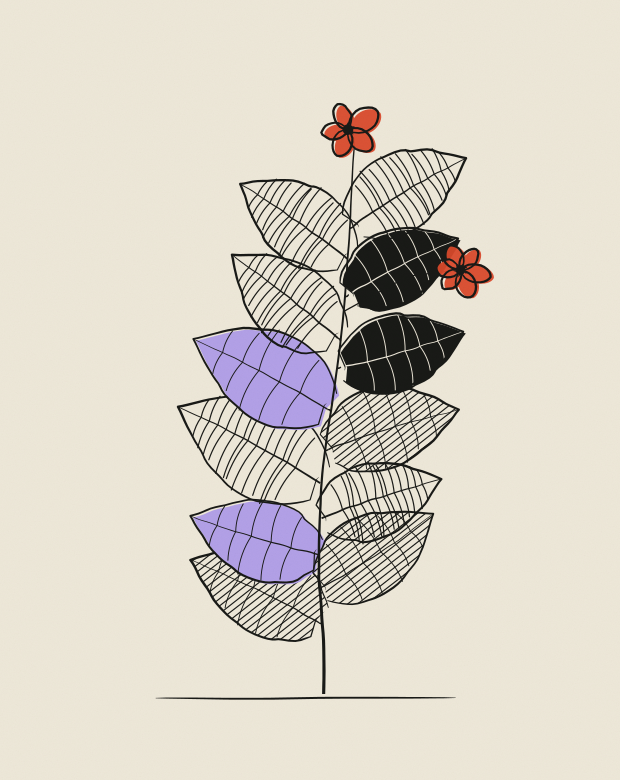
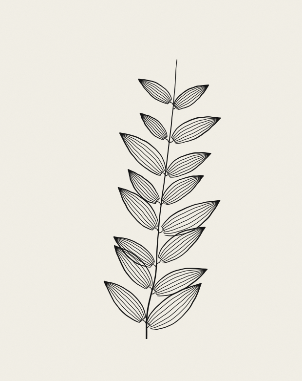
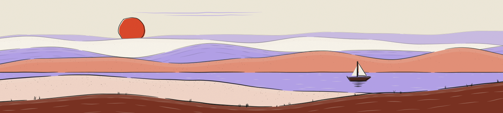

# biome-illustrator

Motor de ilustración generativa en SVG, determinista por semilla. Un número
entero produce una lámina, y el mismo número produce siempre la misma lámina,
byte a byte. Plantas, árboles, nubes y paisajes salen del mismo contrato, con
trazo de pluma, registro imperfecto y grano de papel.

<p>
  
  
  
</p>



- Sin dependencias. Corre en el navegador y en Node.
- Devuelve un string SVG autocontenido: sin fuentes externas ni imágenes.
- Solo ESM, con tipos. Componente React opcional.

## Instalación

```sh
npm install biome-illustrator
# o
pnpm add biome-illustrator
```

| Entrada | Qué trae |
|---|---|
| `biome-illustrator` | el motor: `renderIllustration`, `renderMotif`, `renderPiece`, las piezas del jardín, paletas, formatos, sujetos, `paletteVars`, `toCssColors`, `describeIllustration` |
| `biome-illustrator/core` | primitivas: azar reproducible, ruido, geometría y trazo (`createRng`, `hashSeed`, `lerp`, `clamp`, `makeNoise`, `polyline`, `tapered`, `wobble`, …) |
| `biome-illustrator/react` | `<Illustration />`; necesita `react` 18 o superior (dependencia opcional, solo para esta entrada) |

## Uso

```ts
import { renderIllustration } from 'biome-illustrator'

const svg = renderIllustration({ seed: 4821, subject: 'ink', palette: 'riso' })
document.querySelector('#lamina')!.innerHTML = svg
```

Con React:

```tsx
import { Illustration } from 'biome-illustrator/react'

<Illustration seed={4821} subject="ink" palette="riso" animate />
<Illustration seed={9010} subject="dunes" palette="herbarium" format="wide" animate />
```

El componente inyecta exactamente el string de `renderIllustration`, así que
lo que se ve y lo que se descarga son el mismo archivo.

## Qué hay

- **Siete sujetos**: tres botánicos (`flat`, `ink`, `line`), un árbol
  (`grove`), un cielo grabado (`cumulus`), un paisaje en bandas (`dunes`) y un
  suelo de jardín (`meadow`).
- **Tres formatos**: lámina 620 × 780 (`plate`), banda 1600 × 360 (`wide`) y
  cuadrado 900 × 900 (`square`). Cada sujeto declara cuáles sabe componer.
- **Seis paletas**: `herbarium`, `riso`, `mono`, `night`, `garden` y
  `garden-night`, o una propia.
- **Motivos sueltos**: una planta recortada a su caja, con su punto de apoyo.
- **Piezas de jardín**: sol, luna con fase, matas, margarita, piedra, mata,
  hoja grande, ciprés, árbol redondo, cerros, camino y farol.
- **Crecimiento**: la misma planta de brote a flor (`growth`).
- **Color por variables CSS**, para teñir en vivo sin volver a dibujar.
- **Pluma según el tamaño final** y **registro** configurable entre color y
  línea.

## API

Todas las opciones nuevas son opcionales: sin ellas, el SVG es el mismo byte a
byte.

### `renderIllustration(options): string`

```ts
renderIllustration({
  seed: 4821,
  subject: 'ink',            // flat | ink | line | grove | cumulus | dunes | meadow
  palette: 'garden',         // un id o una paleta propia { paper, ink, accent, …, flower? }
  format: 'plate',           // plate | wide | square
  registration: 2.5,         // desfase entre color y línea, en px (0 a 8)
  animate: false,            // entrada escalonada y deriva suave, en CSS
  grain: true,               // grano de papel
  paper: true,               // false: fondo transparente
  colors: 'hex',             // 'css' → style="fill:var(--bi-ink,#2B2A28)"
  displayWidth: undefined,   // px reales: engrosa la pluma si se ve chico
  growth: 1,                 // 0..1, botánicos: brote → botón (0,45) → flor (0,72)
})
```

### `renderMotif(options): Motif`

Una planta recortada a la caja de su dibujo, transparente, sin línea de suelo,
con el pie del tallo. Sujetos: `line`, `ink`, `flat` y `grove`.

```ts
import { renderMotif } from 'biome-illustrator'
import { hashSeed } from 'biome-illustrator/core'

const m = renderMotif({ seed: hashSeed('reef'), subject: 'line', palette: 'garden',
  growth: 0.4, scale: 0.2, colors: 'css' })
// m.svg                 viewBox="0 0 w h", con width y height en px
// m.width, m.height     tamaño en px
// m.bbox                caja del dibujo, en unidades del viewBox
// m.anchor, m.anchorFrac   pie del tallo (en unidades, y como fracción 0..1)
```

`scale` (px por unidad) deja todas las plantas a la misma escala;
`displayWidth` fija el ancho de cada una.

### `renderPiece(options): string`

Una pieza suelta del jardín, cada una en su lienzo (`PIECE_CANVAS`, se cambia
con `width` y `height`). Las que se paran tienen el pie abajo al centro
(`pieceFoot`).

```ts
renderPiece({ kind: 'moon', seed: 3, palette: 'garden-night', phase: 0.25 })
renderPiece({ kind: 'lantern', seed: 8, palette: 'garden', colors: 'css' })
```

- `kind`: `sun`, `moon`, `tuft`, `daisy`, `stone`, `bush`, `leaf`, `cypress`,
  `round-tree`, `hills`, `trail` o `lantern`.
- **Luna**: `phase` de 0 a 1 (0 nueva, 0,25 cuarto creciente, 0,5 llena), vista
  desde el hemisferio norte.
- **Farol**: de pie, de papel colgado o de piedra; en `renderPiece` la semilla
  elige. A mano, `lantern(p, base, alto, { ink, body, glass }, { style, layer })`
  fija el estilo (`post`, `paper` o `stone`) y dibuja una sola capa (`fill`,
  `glass` o `ink`) con la misma geometría, para encender el vidrio de noche.
- **Cerros**: cada capa usa el mismo color con menos opacidad mientras más
  lejos, así un solo rol los tiñe a cualquier hora.

Las funciones de cada pieza (`daisy`, `stone`, `bush`, `bigLeaf`, `cypress`,
`roundTree`, `hills`, `trail`, `lantern`, `horizon`, `tuft`, `stream`, `sun`,
`moon`) también están exportadas para componer a mano: reciben un `pen(seed)`,
la geometría y los colores.

### Suelo y composición

`meadow` dibuja horizonte, arroyo, matas y sol (luna si el papel es oscuro).
`meadowHorizon(seed, format).y(x)` dice a qué altura queda el suelo en cada
`x`, para plantar encima los motivos:

```ts
const hz = meadowHorizon(7, 'wide')
const ground = renderIllustration({ seed: 7, subject: 'meadow', palette: 'garden',
  format: 'wide', paper: false, grain: false, colors: 'css' })
const plant = renderMotif({ seed: 12, subject: 'ink', palette: 'garden', growth: 0.8,
  scale: 0.2, colors: 'css' })
const x = 640
const left = x - plant.anchorFrac.x * plant.width
const top = hz.y(x) - plant.anchorFrac.y * plant.height // en unidades de la banda
```

### Teñir en vivo

Con `colors: 'css'` cada rol de la paleta es una variable con su valor de
respaldo: `--bi-paper`, `--bi-ink`, `--bi-accent`, `--bi-accent-alt`,
`--bi-shade`, `--bi-mid` y `--bi-flower`. La página las define en cualquier
contenedor, y `paletteVars` arma las declaraciones:

```ts
import { PALETTES, paletteVars } from 'biome-illustrator'

document.body.style.cssText = paletteVars(PALETTES['garden-night'])
```

## Cómo se ve dibujado y no vectorial

- **Grosor variable.** Cada trazo es un polígono relleno, fino en las puntas.
- **Ruido coherente.** Décimas de píxel de desvío, no un filtro.
- **Registro imperfecto.** Un solo número corre la mancha de color respecto a
  la línea, en todo el catálogo.
- **Relleno calado.** Sobre un limbo negro, las nervaduras se dibujan en color
  papel.
- **Oclusión.** La copa del árbol son racimos delante y detrás del esqueleto;
  la silueta aparece sola.
- **Grabado.** Cada cúpula de nube dibuja su propio festón y sus bucles.

## Calidad

Un sujeto no está terminado porque se vea bien una vez. Cada entrada del
catálogo declara su propio criterio, y `pnpm run audit` lo mide en cada
formato:

```ts
quality: { minPaths: 60, minTones: 3, minVariation: 0.3 }
```

- **trazos**: cuántos `<path>` tiene el dibujo.
- **tonos**: cuántos rellenos distintos usa; sin jerarquía de color, todo se
  aplana.
- **variación**: cuánto cambian las piezas (posición y tamaño) entre semillas,
  medido sobre los trazos con relleno, no con una diferencia de píxeles.
- **lienzo** (opcional): cuánto del formato ocupa el dibujo.

Las piezas del jardín pasan por las mismas preguntas en su propio lienzo
(`PIECE_GATES`). Además, `pnpm run snapshot` guarda el hash del SVG de cada
sujeto × formato × paleta × semilla: ningún cambio redibuja lo existente sin
que se note.

## Desarrollo

Requiere Node 20+ y pnpm.

```sh
pnpm install
pnpm dev              # estudio en http://localhost:5199
pnpm typecheck
pnpm run audit        # gate de calidad por sujeto y formato
pnpm run snapshot     # regresión: el SVG de cada semilla, byte a byte
pnpm build            # librería (dist/) + estudio (dist-site/)
pnpm export           # catálogo de SVG en out/
pnpm sheet            # hoja de contactos de seis semillas por sujeto
pnpm run png --subject=ink --growth=0.2,0.5,1   # PNG con resvg
pnpm run gallery      # las imágenes de este README
```

El estudio (`src/studio`) deja editar la semilla, pasar a la siguiente con
`R`, ver ocho variaciones, compartir el estado por la URL y exportar SVG o PNG
al doble de tamaño.

### Arquitectura

```
src/illustration/
├── core/            primitivas, sin saber qué se dibuja
│   ├── prng.ts      azar reproducible (mulberry32) y pesos
│   ├── noise.ts     ruido 1D: el pulso del trazo
│   ├── math.ts      puntos, bézier, marcos tangente/normal
│   ├── path.ts      polilínea → polígono de grosor variable, rayado
│   ├── format.ts    el lienzo como dato
│   ├── palette.ts   papel, tinta, acentos, sombra, medio
│   ├── fill.ts      rellenos de hoja
│   ├── leaf.ts      perfil de hoja, nervaduras, franjas
│   ├── leafDraw.ts  una hoja dibujada, reutilizable por cualquier sujeto
│   ├── flower.ts    pétalos como lazos cerrados
│   └── branch.ts    esqueleto de ramas con ancho que se conserva
├── subjects/
│   ├── types.ts     contrato compose(ctx) → { body, origin, sway }
│   ├── botanical/   especies y composición
│   ├── grove/       árbol: ramas y racimos de hojas
│   ├── sky/         cúmulos festoneados, con bucles
│   ├── dunes/       bandas de paisaje
│   ├── garden/      suelo del jardín y sus piezas
│   └── index.ts     el catálogo: formatos y gate de cada sujeto
├── quality.ts       auditoría de trazos, tonos y variación
├── render.ts        papel, grano, animación, serialización
├── markup.ts        pasadas sobre el SVG: variables CSS, pluma, caja
├── motif.ts         una planta suelta, recortada, con su pie
└── react/           el componente
```

`render.ts` no sabe de plantas ni de nubes: pide a un sujeto que llene la
lámina y después arma el SVG.

## Versiones

La API puede cambiar mientras el paquete esté en `0.x`. Si un cambio
redibuja algo a propósito, sube `ENGINE_VERSION` (va en el atributo
`data-engine` del SVG) y queda anotado en el [registro de cambios](CHANGELOG.md).

## Licencia

[MIT](LICENSE) © Felipe Diaz
